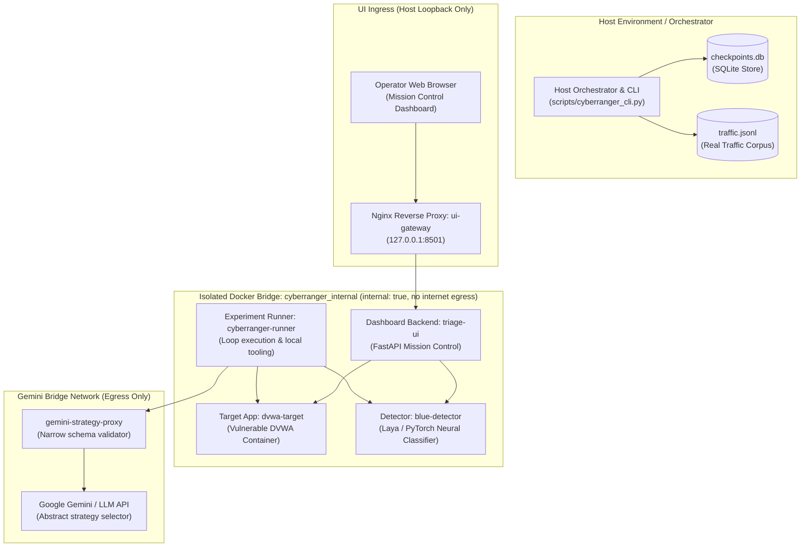
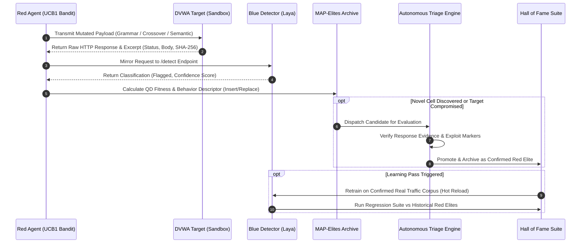
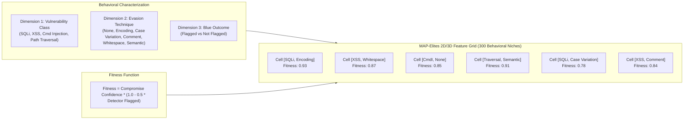
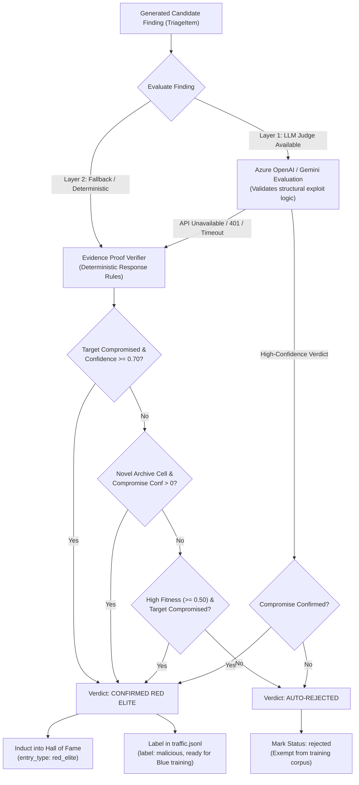

# CyberRanger — Presentation Figures & Architecture Diagrams

This document contains publication-ready figures, architectural block diagrams, sequence workflows, and empirical evaluation metrics for slides and presentation decks.

---

## 1. System Architecture & Strict Sandbox Isolation

This figure illustrates the isolated Docker container topology and network boundary that enforces safe, closed-loop local security research.



> **Slide Takeaways:**
> - **Zero-Trust Network Perimeter:** The vulnerable application (`dvwa-target`) and neural classifier (`blue-detector`) run on an internal-only Docker network with no internet egress.
> - **Controlled External Interface:** External LLM communication is gated behind a narrow proxy (`gemini-strategy-proxy`) that strips raw payloads, URLs, and hashes, transmitting only abstract strategy enums.
> - **Operator Mission Control:** Host access is strictly bound to loopback `127.0.0.1:8501` through an Nginx gateway.

---

## 2. Closed-Loop Co-Evolutionary Workflow

The adversarial loop between Red payload mutation, target execution, behavioral scoring, and Blue continual learning.



> **Slide Takeaways:**
> - **Evidence-Backed Ground Truth:** Payloads are evaluated against real HTTP responses from DVWA; theoretical bypasses without target responses are discarded.
> - **Closed Arms Race:** When Red bypasses Blue and breaches the target, the observation immediately becomes ground-truth training data for Blue.

---

## 3. MAP-Elites Behavioral Search Space (Quality-Diversity)

Instead of searching for a single "best" exploit, CyberRanger maintains a diverse repertoire of attacks across multiple vulnerability classes and evasion transformations.



### MAP-Elites Matrix Overview Table

| Vulnerability Class | None | Encoding | Case Variation | Comment Injection | Whitespace Substitution | Semantic Rewrite |
| :--- | :---: | :---: | :---: | :---: | :---: | :---: |
| **SQL Injection (SQLi)** | Baseline `' OR 1=1--` | URL / Hex Encoded | `sElEcT uSeR()` | `/**/UNION/**/SELECT` | `%09%09OR%091=1` | Natural Language Mutation |
| **Cross-Site Scripting (XSS)** | `<script>alert(1)` | `%3Cscript%3E` | `<sCrIpt>` | `<!-- comment -->` | `` | DOM / Event Mutation |
| **Command Injection (CmdI)** | `; cat /etc/passwd` | Base64 Encoded | `cAt /EtC/pAssWd` | `;/*comm*/id` | `%09cat%09/etc/passwd` | Semantic Subshell |
| **Path Traversal** | `../../etc/passwd` | `..%2f..%2f` | Mixed Traversal | `..;..;` Bypass | Directory Wrapping | `/*semantic*/ ../` |

---

## 4. Autonomous Triage & Red Elite Verification Engine

This diagram outlines how human-in-the-loop triage was automated using a dual-layer verification engine (combining LLM judges with deterministic compromise signatures).



---

## 5. Model Training & Evaluation Metrics

Live performance of the Laya Blue Detector evaluated against held-out evidence-backed traffic observations.

### Confusion Matrix (Detector vs Target Ground Truth)

```
                       PREDICTED MALICIOUS        PREDICTED BENIGN
                  +---------------------------+---------------------------+
ACTUAL MALICIOUS  |   True Positive (TP): 24  |   False Negative (FN): 0  |
                  |  (100% Exploit Catch Rate)|   (Zero Missed Attacks)   |
                  +---------------------------+---------------------------+
ACTUAL BENIGN     |  False Positive (FP): 11  |   True Negative (TN): 13  |
                  | (Benign Flagged by Model) |  (Legitimate Traffic OK)  |
                  +---------------------------+---------------------------+
```

### Key Performance Indicators (KPIs)

| Metric | Measured Value | Operational Interpretation |
| :--- | :---: | :--- |
| **Malicious Recall** | **100.0%** | Zero false negatives: every genuine exploit was successfully detected. |
| **Overall Accuracy** | **77.1%** | Balanced classification accuracy across real benign and malicious DVWA traffic. |
| **Malicious Precision** | **68.6%** | Low false alarm penalty while maximizing security detection. |
| **F1-Score** | **0.814** | High harmonic mean between precision and recall. |
| **Regression Floor** | **100.0%** | Maintained 100% stability against all historical Red Elites in the regression suite. |

---

## 6. Live Dashboard & Telemetry Visuals

### Telemetry & Model Evaluation View
This screenshot displays the live model evaluation cards, benchmark progress tracks, confusion matrix, and generation history:


### Mission Control Overview (Sage & Olive Editorial Theme)
The primary operator dashboard showing lab health, co-evolution controls, archive coverage, and live service status:


### Hall of Fame & Auto-Triaged Red Elites
The Hall of Fame archive containing verified Red Elites auto-confirmed by the verification engine:


---

## 7. Slide Deck Outline (Suggested Slide Structure)

1. **Title Slide**: CyberRanger: Autonomous Co-Evolutionary Web Security Research & Continual Learning
2. **Problem Statement**: Static security rules fail against mutating evasions; traditional benchmarks lack real execution evidence.
3. **Architecture (Fig 1)**: Strict Docker sandbox isolation, internal-only bridges, and secure proxy egress.
4. **Co-Evolution Loop (Fig 2)**: The arms race: UCB1 Bandit red mutations vs PyTorch/Laya blue classification.
5. **Quality-Diversity (Fig 3)**: MAP-Elites exploration across vulnerability classes and evasion transformations.
6. **Autonomous Triage (Fig 4)**: Eliminating human bottlenecks via dual-layer LLM and deterministic evidence verification.
7. **Empirical Results (Fig 5)**: 100% exploit recall, 77.1% accuracy, and confusion matrix breakdown.
8. **Live Telemetry & Dashboard (Fig 6)**: Mission control interface and generation growth curves.
9. **Conclusion & Future Directions**: Scaling multi-turn attack chains and expanding zero-shot model generalization.
